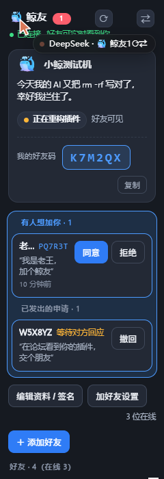
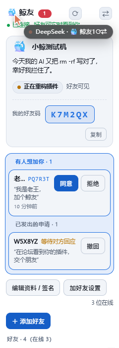

# 🐳 dsh-friends — DSH 鲸友好友系统

和同样在用 DeepSeek Harness 的好友互相看见：**是否在线、是不是在跑任务、最近忙什么**，还能改一条有趣的个性签名、戳一戳。

这不是"好友在不在"，而是"**他的 AI 在不在、忙不忙**"——一种人机混合的社交。

 

## 📸 截图

| 深色主题 | 浅色主题 |
| --- | --- |
|  |  |

---

## ✨ 功能

| 功能 | 说明 |
| --- | --- |
| 🟢 实时在线状态 | 开 DSH 就在；关掉就走。8 秒心跳，3 个心跳没见判定离线 |
| 🟡 任务状态 | 模型跑任务时自动变"忙碌"，你能看到他正在干什么 |
| 🔴 异常提醒 | 任务卡住/报错，好友那边显示红色，可以过去救他 |
| 🤝 好友申请 | 默认**需要对方同意**；也可切成**无需同意，谁加都直接通过** |
| 🔗 邀请链接 | 一键生成 `dsh-friends://add?code=…`，朋友粘贴即自动识别好友码 |
| 📥 申请收件箱 | 待处理申请（同意/拒绝）+ 已发出申请（撤回），标题栏有未处理数量徽章 |
| ✎ 个性签名 | 随时改，好友列表里显示；也可以让模型读你这几天的活自动写一条 |
| 🐳 心情 emoji | 一键切换心情，跟随签名一起展示 |
| 👉 戳一戳 | 好友的鲸鱼头上飘个 emoji；在线才生效 |
| 🏷 备注名 | 给好友改个只有自己看得见的备注，点铅笔内联编辑 |
| 🥷 隐身模式 | 在线但不广播，好友看到你离线 |
| 🔐 端到端加密 | AES-GCM 256，密钥由好友码派生；公共中继只看得到密文 |
| 🚫 零注册零登录 | 没有账号体系，6 位好友码即密钥 |

## 🚀 安装

> ⚠️ 本插件**还没有发布到 npm**，请用下面任意一条命令（都实测可用）。

**方式一：预构建包（推荐，最快）**
```
dsh plugin --profile web add https://github.com/zlwzk/dsh-friends/releases/latest/download/dsh-friends.tgz
```

**方式二：直接从 GitHub 源码装**
```
dsh plugin --profile web add github:zlwzk/dsh-friends
```

桌面版把 `--profile web` 换成 `--profile desktop`。装完**重启 DSH**，左侧栏会出现「🐳 鲸友」入口。

> 等收录进 awesome-dsh-plugin 市场后，也可以在插件市场里一键安装（无需命令）。

## 🤝 怎么加好友

**方式一：好友码**
1. 打开面板，复制你的 **6 位好友码**（「我的好友码」那一行）发给朋友
2. 对方点「＋ 添加好友」，粘贴码或链接 →「发送申请」
3. 你收到申请（标题栏徽章 +「好友请求」卡片）→ 点「同意」
4. 双方成为好友，立刻能看到在线/任务状态

**方式二：邀请链接**
- 点「加好友设置」→「邀请链接」→ 复制
- 链接形如 `dsh-friends://add?code=K7M2QX`，朋友粘贴进添加框即可，会自动识别出好友码

**两种同意模式**（在「加好友设置」里切换）

| 模式 | 别人加你时 |
| --- | --- |
| **需要我同意**（默认） | 你收到申请，点「同意」才成为好友 |
| **无需同意** | 任何人输入你的码都**直接成为好友**，你只会收到一条通知 |

> 你切成「无需同意」，只影响别人加你；你加别人时仍尊重对方的设置。

## 🔒 隐私与安全

- **好友码是共享密钥**：密钥 = HKDF(SHA-256, "dsh-friends/v1:" + 好友码)
- 每条消息用随机 12 字节 IV 的 AES-GCM 加密；频道主题可被猜到，但没有码解不开
- 消息内容只有：昵称、签名、心情、状态、任务标签、时间戳、好友申请与留言——**不包含任何会话内容、文件、或代码**
- 默认关闭 DSH 页面时发送 `bye`，好友立刻看到你下线
- 删除好友会通知对方（对方列表里也会移除你）；拒绝申请不通知（避免尴尬）
- 「无需同意」有风险：好友码一旦公开，任何人都能直接加你。不确定就先留在默认的「需要我同意」

## 🛠 技术

- 客户端零依赖：手写 MQTT 3.1.1 over WebSocket（CONNECT/SUBSCRIBE/PUBLISH/PING），不用 mqtt.js
- WebCrypto API 做 AES-GCM，无任何 polyfill
- 多公共中继自动故障转移（emqx / hivemq，并发探测选活的）
- Host 侧只做本机三件事：资料持久化、任务状态暂存、注册模型工具
- 测试：`node --test test/`

## 🧰 模型工具（给 AI 用）

安装后你的 AI 多了四个工具：

- `friend_profile` — 查看/更新自己的昵称、签名、心情（也会报告当前同意模式与隐身状态）
- `friend_task` — 上报"我在忙/我忙完了/我卡住了"，好友能看到
- `friend_sign_idea` — 让模型根据最近干的活写一条搞笑签名（60 字内）
- `friend_inbox` — 查看好友申请收件箱（谁加了你、你加了谁），只读

你可以直接对模型说：「更新一下我的鲸友签名」「我现在要跑个大活，告诉好友别戳我」「看看有没有人加我」。

## ⚠️ 已知限制

- 公共 broker 是免费社区服务，不保证 SLA；高峰期可能延迟（已做多节点探测与重连）
- 状态广播间隔 8 秒，不是毫秒级
- 好友双方至少一方要开着 DSH 网页/桌面端才能互见
- 好友申请需要对方在线才能送达（对方离线时申请会留在本地待发，下次上线不自动重发——可以重新发一次）
- 截图来自渲染 harness（真实 client.js + 真实 React 渲染，主题走宿主同一条 `data-ds-dark-theme` 路径），非桌面应用内实拍

## 🩺 收不到好友申请？

面板右上角有 **⟳ 刷新** 按钮，可以先手动拉一次。如果还是没有：

1. 确认标题栏的连接状态是「已连接」（不是「重连中」/「连接被拒」），不是就点 **⇄** 换中继节点
2. 确认对方**当时开着 DSH**——申请是实时消息，对方不在线收不到，需要重发
3. 确认你没有把对方误判了：如果你切成了「无需同意」，对方加你会直接成功，不会出现在申请列表里
4. 让对方重新发一次申请（旧的申请不会自动重投）

## 📄 License

MIT
